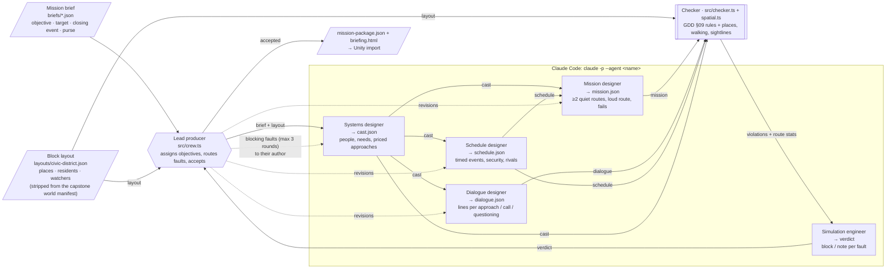

# The Suborned · Mission Crew

Five Claude Code agents, coordinated by a lead-producer orchestrator, that **generate a playable, rule-checked mission for _The Suborned_**, my capstone game.

## The game

**The Suborned** is a single-player real-time tactics and social-infiltration game for PC, built in Unity. You command a four-person cell (Scout, Fixer, Tech, Enforcer) in a bright retro-future city. You can shoot your way through, but every shot raises Alert and Trail and draws rivals and patrols. The stronger play is to turn ordinary people, such as a waitress in debt or a driver who needs cash, and time their small acts into one plan. A mission is one city block on a live 8–12 minute clock.

The design rule this crew serves (GDD §09): **nothing is hand-authored, and there is no AI at runtime.** Missions are generated at build time and must pass the mission checker before a player sees them. The training mission, *Handover*, is the reference case. The generator must match its quality, and the checker must pass it.

## What the crew produces

Given a mission brief (objective, target, closing event, purse) and a **block layout**, the crew outputs `out/<brief>/mission-package.json`: build-time mission data designed for the Unity build to import. The importer itself is outside this assignment.

| Part | Content | Used in game for |
|---|---|---|
| `cast` | the target plus 2–4 contacts: temperament, one clear need, how the Scout learns it, priced approaches (Ask / Pay / Help / Pressure), the act each does when turned | people simulation, action cards with full price |
| `schedule` | timed events with in-world reasons, the closing event, security, rival arrival | the mission clock, "Next Event" |
| `mission` | ≥ 2 quiet routes and 1 loud route as timed operative steps, fail conditions, both fight branches | the plan the player can discover; win/fail logic |
| `dialogue` | one line per person per approach, plus refusal, confirming a call, and being questioned | contact barks and investigator answers |
| `check` | per-route cost, Trail, Alert and finish time, plus any rule violations | build gate |

It also writes `briefing.html`, a dossier view for design review, `report.json`, which records every round and verdict plus token totals per agent and overall, and `run.log`.

A sample run is committed in [`out/handover/`](out/handover/). The crew was given only the **template of the GDD's own training mission, Handover** (objective, target, closing event, purse) and generated its own people, clock and routes. See [Sample run](#sample-run-the-crew-at-work) below for how it got there.

## The block layout

The crew designs missions **inside a block that already exists**, the way Hitman writes many missions into one map. The block is the capstone's own world: `src/extract-layout.ts` strips the game's 388 KB world manifest (`game-source/experiments/civic-2p5d/world-manifest.json`) to a 2 KB [`layouts/civic-district.json`](layouts/civic-district.json):

- **places**: 15 named spots with coordinates in metres and tags for what can happen there (`meet`, `watch`, `entrance`, `device`, `vehicle`, `interior`)
- **residents**: who the world already has on the block at 0:00: Vale in the civic office, Inez at the café, the driver at the official car, and the rival crew's arrival point
- **watchers**: what each camera, guard and patrol sees, how long one blinding lasts, and the patrol's sweep gap
- **walk speed**, so a distance becomes a walk time
- **crew start**: all four operatives begin at the getaway car (bottom left), found from the manifest's `crew-car`

Agents never write coordinates; they pick place and watcher ids from that list. The world decides **who is where**; the crew decides **what they want, what they cost and what they'll do**, plus the clock and the routes. Trees, render data and staging poses are dropped. Rivals, cameras and the patrol sweep aren't in the manifest yet, so [`layouts/civic-district.overlay.json`](layouts/civic-district.overlay.json) adds them (from the prototype sim) until it carries them. Re-extract with `bun run layout` when the world changes. The extracted layout is committed, so the crew and the tests run without the game project; only re-extracting needs it checked out at `../../game-source`.

## The crew

The roles are cut from the game's **Agentic Design Document (ADD v0.12)**. It defines a 15-agent studio. This crew takes its content-generation chain: *lead assigns → systems designer rules → mission · schedule · dialogue designers → simulation engineer checks → lead accepts*. Each agent's prompt is its ADD role card. The ADD gives each role a studio name (Aster, Motive, Pulse, Waymark, Fable, Keel). Here the agents use job titles instead, and `CLAUDE.md` maps one to the other.

| Agent (`.claude/agents/`) | Input | Output | Why the pipeline breaks without it |
|---|---|---|---|
| [**lead-producer**](.claude/agents/lead-producer.md) (orchestrator, `src/crew.ts`) | brief, the simulation engineer's verdict | objectives for each agent, revision routing, accept / reject | nothing assigns work, routes faults or decides when a mission ships |
| [**systems-designer**](.claude/agents/systems-designer.md) | brief, layout | `cast`: the block's residents given needs and prices, plus any people it adds | no people or prices. Every other agent builds on the cast |
| [**schedule-designer**](.claude/agents/schedule-designer.md) | brief, layout, cast | `schedule` (events move people between places) | routes have no clock. The mission designer's `after`/`before` steps reference schedule event ids |
| [**mission-designer**](.claude/agents/mission-designer.md) | brief, layout, cast, schedule | `mission` (every step at a place) | no routes, so there is nothing to play |
| [**dialogue-designer**](.claude/agents/dialogue-designer.md) | brief, cast | `dialogue` | the checker rejects any contact without lines, so the package can't pass |
| [**simulation-engineer**](.claude/agents/simulation-engineer.md) | full package, checker report, its previous verdict | `verdict`: each fault assigned to its author, marked `block` or `note`, with a concrete fix | faults reach nobody. It also judges what code can't, such as a turned contact's act that doesn't open the window a route uses |

Between the designers and the simulation engineer sits a deterministic checker (`src/checker.ts`), the ADD's *Keel + Splice check* step. It runs the **mission checker**, which the ADD assigns to the mission designer, plus the **rulebook rules** the simulation engineer keeps:

- the §03 cell verbs
- §04 knowledge-before-turning, with prices matching the systems designer's table
- §05/§06 shot costs (+2 Trail per shot; a firefight is one Alert incident, as ruled) and the Alert cap (0–3)
- the §09 mission checker: ≥ 2 quiet routes win, the loud route costs more Trail, every fail is reachable, no contact is essential, and the fastest informed route has 60 s to spare
- **spatial rules** against the layout (`src/spatial.ts`): every place exists; the block's residents are in the cast at their places; a Turn or Take happens where the person is at that moment; Watch and Listen are within 15 m; every operative walks from the getaway car to its first step and between steps in the time given; and on quiet routes no camera, guard or patrol sees an Enter or Take complete unless a step or event blinded it first (§07: "entry seen by guard, live camera or patrol")

`bun test` proves the checker passes *Handover*, hand-encoded on the capstone block, and rejects broken missions on twelve different rules.

## Architecture



(Also in [`crew.mmd`](crew.mmd).)

**Flow.** The systems designer runs first. Then *schedule designer → mission designer* runs in parallel with the *dialogue designer*, which needs only the cast. The checker and the simulation engineer review the whole package. The lead sends each **blocking** fault (checker violations plus the engineer's `block`s) to its author along with the author's previous output. The author changes only what the notes require, and anything downstream of a changed output re-aligns. Later reviews get the engineer's previous verdict. It confirms the old blocks are fixed and blocks only on new faults the revision introduced, so the loop converges. After three revision rounds the lead stops, writes the report and exits non-zero rather than shipping a failing mission.

**Handoffs.** Every output is constrained by a JSON schema (`src/schemas.ts`, via `--json-schema`) and validated again with Zod before the next agent sees it. That follows the ADD rule: handoff = inputs · done-check · next owner.

## Sample run: the crew at work

`bun run crew briefs/handover.json` produced *Handover: Councillor Vale, Civic Records block*. It was **accepted after 3 rounds and 15 agent calls**, about 21 minutes of agent time. The console log is [`out/handover/run.log`](out/handover/run.log). Every verdict, the per-call usage and the token totals are in [`report.json`](out/handover/report.json), and [`briefing.html`](out/handover/briefing.html) is the dossier.

**What it made from the block's residents.** The world fixed who is where; the crew decided the rest:

- **Inez**, café waitress (Mercenary): owes a moneylender $40,000. Turned, she messages the guard (her lover) to meet behind the café, and he leaves his post for 120 s.
- **The driver** (Idealist): his sister's family is being evicted under *Vale's own clearance order*. Clearing their $40,000 deposit turns him, and on cue he moves the official car to the service lane. The crew invented this tie-in to the GDD's premise; nobody asked for it.
- **Purse lesson:** paying Inez costs $70,000, and as an Idealist the driver refuses money. Learning their needs is what makes a $40,000 route possible.

| Route | How | $ | Trail | Alert | Vale taken |
|---|---|---|---|---|---|
| A · quiet | Scout listens to Inez → Fixer clears her debt → Tech loops the entrance camera, then reroutes the patrol bot → Inez draws the guard off → Enforcer enters in the patrol's blind spot | $40,000 | 1 | 0 | 4:12 |
| B · quiet | no Inez: Scout learns the driver's need → Fixer helps him → Scout's false tip sends the rivals away → the driver moves the car → Enforcer takes Vale in the service lane | $40,000 | 1 | 0 | 6:28 |
| L · loud | Tech loops the camera and reroutes the bot so it doesn't break toward gunfire → Enforcer shoots the guard (2 shots) → enters | $0 | 4 | 2 | 3:29 |

Every route ends in the rivals firefight. Loud, security sides with the rivals and police close from the west street. Quiet, the guard who never saw you fights the rivals, Inez warns you 10 s early (A), and the driver blocks the rival car (B).

| # | round | agent | time | input tokens | output tokens |
|---|---|---|---|---|---|
| 1 | 0 | systems-designer | 74 s | 38,279 | 4,984 |
| 2 | 0 | dialogue-designer | 32 s | 8,677 | 1,079 |
| 3 | 0 | schedule-designer | 79 s | 26,418 | 5,093 |
| 4 | 0 | mission-designer | 269 s | 77,913 | 20,839 |
| 5 | 0 | simulation-engineer | 238 s | 116,004 | 18,504 |
| 6–9 | 1 | all four designers | 179 s | 61,732 | 14,788 |
| 10 | 1 | simulation-engineer | 107 s | 26,181 | 9,320 |
| 11–14 | 2 | all four designers | 215 s | 91,364 | 19,463 |
| 15 | 2 | simulation-engineer | 78 s | 25,457 | 5,736 |

**Round 0: 3 checker violations, 6 blocks.** The checker caught an entry that completes before the camera loop is in place, and a Take where Vale isn't at that moment. The simulation engineer found what code can't: the driver's move had no schedule event behind it, the unwatched service-lane door made a free route better than every other, and nothing triggered the rival fight on quiet routes.

**Round 1: 2 new blocks.** All 6 were fixed, but the fix over-corrected: the door was now written as opening "only for Vale", which locked the exits routes A and L use. The same fault was in the cast and the schedule, so both owners got it.

**Round 2: accepted**, with 7 notes left for a later pass.

### Getting here: four runs

| Run | What the crew had | Result |
|---|---|---|
| 1 | brief only; positions described in prose | **not accepted** after 4 rounds, 18 calls, 614k tokens. Most blocks were spatial contradictions ("the guard can see the door from the café") that no one could settle without a map |
| 2 | + the block layout | **accepted** after 2 rounds, 8 calls, 388k tokens. Places, walking and sightlines moved into the checker |
| 3 | + residents and canon (Inez, the driver, Vale, the rivals) | **not accepted** after 4 rounds, 17 calls, 653k tokens. The only open block was a contradiction in the GDD itself: §06 says each shot is +1 Alert, §05 says gunfire is one incident. The simulation engineer refused to let the mission designer flip between the two readings and escalated it, as the ADD requires for an unresolved rule conflict |
| 4 | + the director's ruling (Alert per incident, +2 Trail per shot), written into §06 and the checker | **accepted**, the run above |

Run 3 is the crew working as designed: it would not ship a mission it couldn't replay exactly, and it named whose decision it was.

### What the simulation engineer flagged for the checker

It asked for four checker changes it currently does by hand. They are next steps, not done:

- run the "seen" check on loud routes too
- make an actor's place respect conditional events (Vale exits north *or*, if the driver is turned, by the service lane)
- treat a deadline event as a latest time, not a fixed one
- make the carry from the Take to the getaway car a step, so its path through watcher areas is checked (route A's carry passes the guard's area with about 30 s to spare)

An earlier run found two real checker bugs the same way, both fixed with tests: a camera loop is tethered (it holds only while the Tech stays at the cabinet), and the shot rule above.

### Tokens

| agent | calls | input | output | total |
|---|---|---|---|---|
| systems-designer | 3 | 65,135 | 9,797 | 74,932 |
| dialogue-designer | 3 | 29,702 | 3,968 | 33,670 |
| schedule-designer | 3 | 57,294 | 12,036 | 69,330 |
| mission-designer | 3 | 152,252 | 40,445 | 192,697 |
| simulation-engineer | 3 | 167,642 | 33,560 | 201,202 |
| **overall** | **15** | **472,025** | **99,806** | **571,831** |

Input includes cached context. The simulation engineer and mission designer use the most: the engineer reads the whole package each round, and the mission designer rewrites every route when anything upstream changes. Every run writes these totals to `report.json`, `run.log` and the dossier.

## How it uses Claude Code

The ADD builds each spawn prompt in layers. Each layer maps onto a Claude Code feature:

| ADD layer | Here |
|---|---|
| 1 · agent GDD §01 core, identical for everyone | `CLAUDE.md`, which imports `docs/gdd/core.md`. Claude Code loads it for every agent |
| 2 · identity (Anima) | not used |
| 3 · role card | `.claude/agents/<name>.md`: the ADD card plus this crew's input/output contract. Each sets `model: opus` and `tools: Read, StructuredOutput` |
| 4 · objective | the prompt `src/crew.ts` sends, in the ADD's form: task · input JSON · done when · evidence · next owner, plus the simulation engineer's blocking faults on revisions |
| "open other sections on demand" | agents `Read` `docs/gdd/02–09.md` only when they need them |

Each agent runs as `claude -p --agent <name> --json-schema … --effort <level>` (`src/claude.ts`). The scripted run above is the tested path. The same agent files are also set up for interactive use: `claude --agent lead-producer` starts the lead producer as the main session, with instructions to run the crew or delegate one objective to one agent.

## Run it

**No need to run it to review it.** The sample run's full output is committed in `out/handover/`. `bun test` needs only Bun.

To generate a new mission you need [Bun](https://bun.sh) and a logged-in [Claude Code](https://claude.com/claude-code) CLI (`claude`). No API key is needed; the crew uses your Claude Code login. One run takes about 20 minutes.

```bash
bun install
```

```bash
bun test
```

```bash
bun run crew briefs/handover.json
```

```bash
bun run check out/handover/mission-package.json
```

To make a new mission, copy `briefs/handover.json`, change the objective, target and closing time, and run the crew on it. To use a new block, write its overlay (which places, their tags, the watchers), run `bun run layout layouts/<block>.overlay.json`, and point the brief's `layout` at the result.

## Layout

```
CLAUDE.md                 layer 1: §01 core (imports docs/gdd/core.md)
.claude/agents/*.md       layer 3: ADD role cards, one per job title
docs/gdd/*.md             agent-GDD sections opened on demand (§02–§09, §11), per each card's ADD `opens` list
briefs/                   mission templates (input); handover.json is GDD §07's template
layouts/                  block layouts the crew designs in; *.overlay.json picks places and adds watchers
src/crew.ts               the lead producer's loop: orchestration, revision routing, acceptance
src/claude.ts             runs one agent via headless Claude Code
src/schemas.ts            handoff contracts (Zod → JSON Schema)
src/checker.ts            mission checker + rulebook rules as code (GDD §03–§06, §09)
src/spatial.ts            places, reach, walking and sightlines against the layout
src/extract-layout.ts     world manifest → layout
src/render.ts             briefing.html dossier
src/usage.ts              token, time and cost totals per agent and overall
fixtures/handover.ts      GDD §07 Handover, the reference case
test/checker.test.ts      checker passes Handover, rejects broken missions
test/usage.test.ts        token totals
out/<brief>/              generated mission package, dossier, report, run.log
```

## Notes

- **Models.** The ADD assigns Claude Opus 5.5 to the systems designer, mission designer and simulation engineer, and GPT 6.1 Sol to the schedule and dialogue designers. This crew is Claude-only, so all five run on Opus 5.5 (`model: opus`), with effort set per role: mission designer and simulation engineer `high`, dialogue designer `low`.
- **Deviations from the ADD.** The crew follows the ADD's spawn layers, role cards and design handoff chain. Where it differs:
  - The schedule designer runs before the mission designer, not alongside it, because routes reference schedule event ids. The dialogue designer still runs in parallel.
  - The simulation engineer reviews the dialogue lines. The ADD has the systems designer review them.
  - Schedule events don't carry the rulebook's needs · changes · witnesses fields yet. Sightlines are checked against the layout's watcher areas (polygons), not by ray-casting against buildings, and walking is straight-line distance.
  - The chain stops at an accepted package. Building it in Unity, playtesting and code review (Latch, Suture, Redline) are outside this assignment.
- **Sources.** The role cards and GDD sections are cut from `the-suborned-agent-gdd-v0.12.0-2026-09-30.md` and the ADD v0.12. Where they disagree with the human GDD, the GDD wins.
